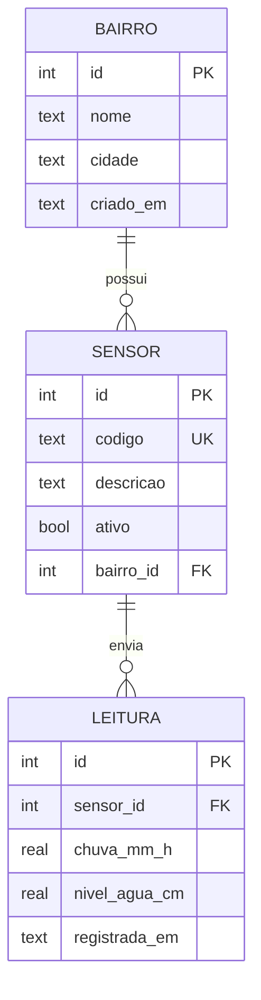

# AlertaChuva - API de Sensores

> **Disciplina:** Arquitetura Orientada a Serviços (SOA) e Web Services · **Global Solution FIAP 2026.2 - CitizenTech**

API REST que gerencia **bairros**, **sensores** de chuva/nível de água e **leituras**, e calcula o **risco de enchente** de cada bairro. É a camada de backend de sensores do projeto AlertaChuva.

## Ficha da CitizenTech

| Campo | Resposta |
|---|---|
| **Nome da CitizenTech** | AlertaChuva |
| **Cidade e bairro** | São Paulo, bairro: Jardim Pantanal |
| **Cidadão beneficiado** | Morador de área de risco de alagamento ou deslizamento que hoje descobre a chuva forte tarde demais |
| **Problema, em uma frase** | Moradores de áreas de risco não recebem alerta a tempo de se proteger de enchentes durante chuvas intensas |
| **Como funciona** | Um sensor ESP32 mede chuva e nível da água e envia as leituras à API; o sistema classifica o risco do bairro (Baixo, Moderado ou Alto) e o app avisa o morador |
| **O que cada parte faz** | **Este repositório (SOA):** API de sensores, leituras e risco · Backend de moradores e alertas (C#) · Modelo de ML com dados do INMET · Circuito ESP32 no Wokwi · App mobile · Infraestrutura Linux · Cybersecurity · Testing (Azure Boards) |
| **Link do repositório** | https://github.com/luccavale/alertachuva-sensores-api |
| **Indicador de impacto** | Minutos de antecedência do alerta e número de moradores alertados por evento de chuva |
| **ODS conectados** | **ODS 11** (Cidades e comunidades sustentáveis), **ODS 13** (Ação contra a mudança global do clima) e **ODS 3** (Saúde e bem-estar) |

## Integrantes

- Lucca Natario do Vale - RM95688
- Thiago Feltrin Geraldes - RM555805
- Danilo Affonso Luz Rios - RM554791

## Tecnologias

Node.js 20+ · TypeScript · Express 4 · SQLite (`better-sqlite3`) · Drizzle ORM (com migrações) · Zod (validação) · Swagger (`swagger-jsdoc` + `swagger-ui-express`) · Jest + Supertest (testes)

## Domínio



Regras: um bairro tem vários sensores e um sensor tem várias leituras. Apagar um bairro apaga (em cascata) seus sensores e leituras. O código do sensor é único.

## Como executar

Pré-requisito: **Node.js 20 ou superior** (recomendado a versão LTS).

```bash
npm install
npm run db:migrate     # cria o banco SQLite em data/alertachuva.db aplicando as migrações
npm run seed           # (opcional) dados simulados: 1 bairro, 1 sensor, 3 leituras
npm run dev            # sobe a API em http://localhost:3000
```

- **Swagger (documentação e testes dos endpoints):** http://localhost:3000/docs
- **OpenAPI em JSON:** http://localhost:3000/docs.json
- **Verificação de saúde:** http://localhost:3000/health

Outros comandos: `npm test` (testes) · `npm run build` e `npm start` (versão compilada).

Variáveis opcionais (veja `.env.example`): `PORT` e `DATABASE_FILE`.

> Se a instalação do `better-sqlite3` falhar, use o Node.js LTS (20 ou 22), pois ele traz binários prontos para essas versões.

## Banco de dados e migrações

O esquema fica em `src/db/schema.ts` e as migrações SQL versionadas ficam em `drizzle/`.

```bash
npm run db:generate    # gera uma nova migração quando o schema.ts muda
npm run db:migrate     # aplica as migrações pendentes
```

A migração inicial é `drizzle/0000_criar_tabelas_iniciais.sql`. A API também aplica as migrações ao iniciar.

## Endpoints (`/api/v1`)

| Método | Rota | Descrição | Respostas |
|---|---|---|---|
| POST | `/bairros` | Cadastra um bairro | 201, 400 |
| GET | `/bairros` | Lista os bairros | 200 |
| GET | `/bairros/{id}` | Busca um bairro | 200, 400, 404 |
| PUT | `/bairros/{id}` | Atualiza um bairro | 200, 400, 404 |
| DELETE | `/bairros/{id}` | Remove um bairro | 204, 404 |
| GET | `/bairros/{id}/risco` | Calcula o risco de enchente do bairro | 200, 404 |
| POST | `/sensores` | Cadastra um sensor | 201, 400, 404, 409 |
| GET | `/sensores?bairroId=` | Lista sensores (filtro opcional) | 200 |
| GET | `/sensores/{id}` | Busca um sensor | 200, 404 |
| PUT | `/sensores/{id}` | Atualiza um sensor | 200, 400, 404, 409 |
| DELETE | `/sensores/{id}` | Remove um sensor | 204, 404 |
| POST | `/leituras` | Registra uma leitura de sensor | 201, 400, 404 |
| GET | `/leituras?sensorId=&bairroId=&limite=` | Lista leituras (mais recentes primeiro) | 200, 400 |

Todos os erros seguem o formato `{ "erro": "mensagem", "detalhes": [...] }`.

### Exemplo: registrar uma leitura

```json
POST /api/v1/leituras
{
  "sensorId": 1,
  "chuvaMmH": 12.5,
  "nivelAguaCm": 35
}
```

Faixas aceitas: chuva de 0 a 500 mm/h e nível da água de 0 a 1000 cm. Valores fora da faixa retornam **400**.

## Regra de negócio: risco de enchente

`GET /api/v1/bairros/{id}/risco` usa a **leitura mais recente** entre os sensores do bairro:

| Risco | Condição |
|---|---|
| **Alto** | chuva ≥ 50 mm/h **ou** nível da água ≥ 100 cm |
| **Moderado** | chuva ≥ 25 mm/h **ou** nível da água ≥ 50 cm |
| **Baixo** | demais casos |

Os limiares são **didáticos** e ficam em `src/config/risco.ts`, para serem ajustados sem alterar o restante do código.

## Testes automatizados

```bash
npm test
```

São 30 testes (Jest + Supertest) com banco SQLite em memória e migrações aplicadas: CRUD de bairros e sensores, regras de validação (400), não encontrado (404), conflito (409), exclusão em cascata, leituras, classificação de risco e documentação Swagger.

## Estrutura do projeto

```
src/
  config/        configurações e limiares de risco
  db/            schema, conexão, migração e seed
  schemas/       validação de entrada (Zod)
  services/      regras de negócio (Bairro, Sensor, Leitura, Risco)
  controllers/   camada HTTP
  routes/        rotas + anotações Swagger
  middlewares/   tratamento de erros centralizado
  docs/          configuração do Swagger
tests/           testes automatizados
drizzle/         migrações SQL versionadas
docs/prints/     evidências da aplicação
```

## Evidências da aplicação

Prints em `docs/prints/`:

1. `01-migracao.png` - `npm run db:migrate` aplicando a migração
2. `02a-swagger-bairros.png`, `02b-swagger-sensores.png` e `02c-swagger-leituras.png` - Swagger UI com os endpoints de cada recurso
3. `03-post-leitura.png` - POST /leituras com resposta 201
4. `04-risco.png` - GET /bairros/{id}/risco com o risco calculado
5. `05-erro-validacao.png` - leitura inválida retornando 400
6. `06-testes.png` - `npm test` com todos os testes passando

## Dados e IA

- **Dados:** todos os dados são **simulados** (nenhum dado pessoal real).
- **IA como copiloto:** os prompts usados estão registrados em [`prompts.md`](prompts.md).
